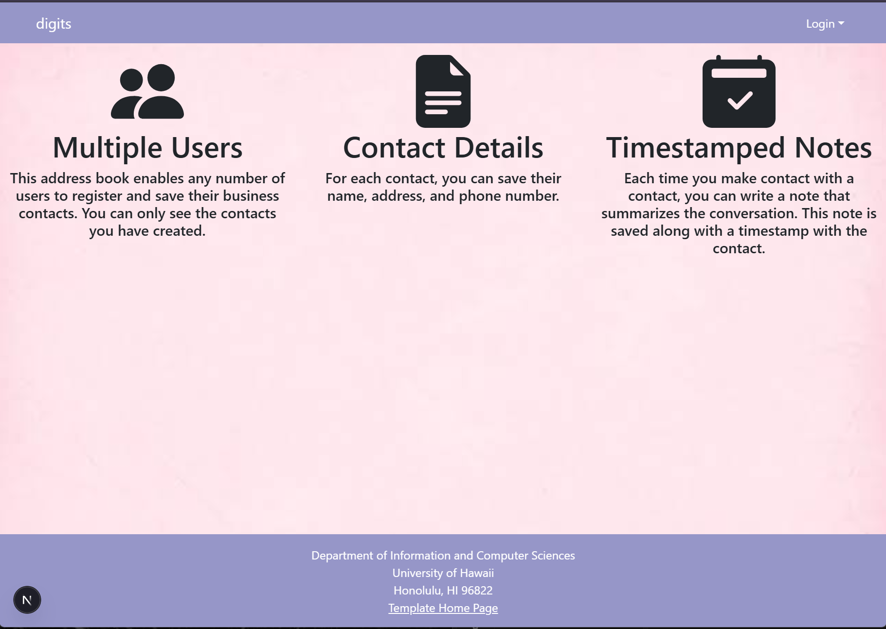
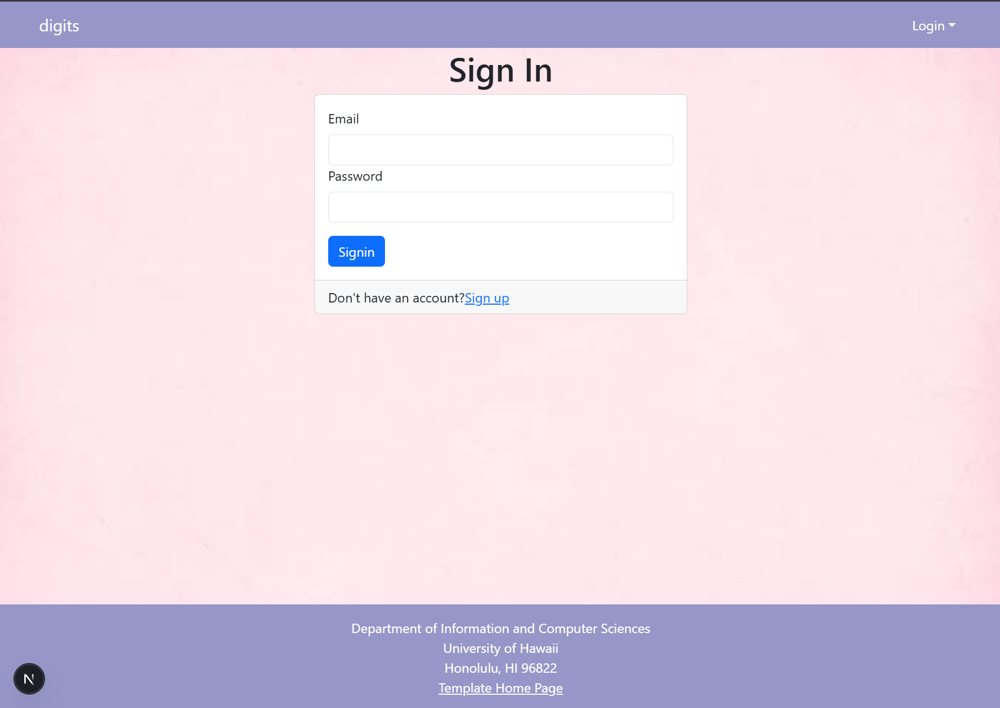
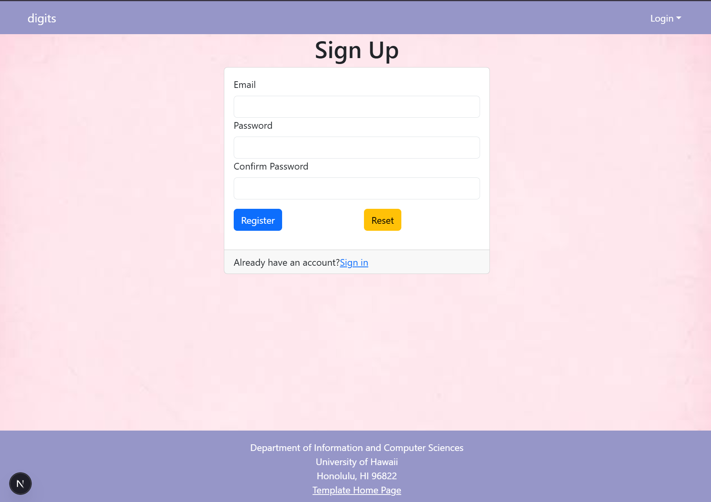
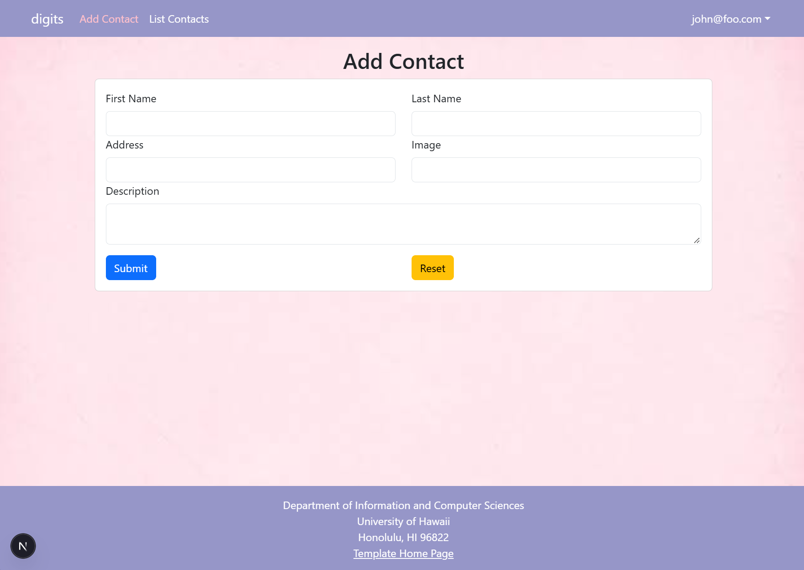
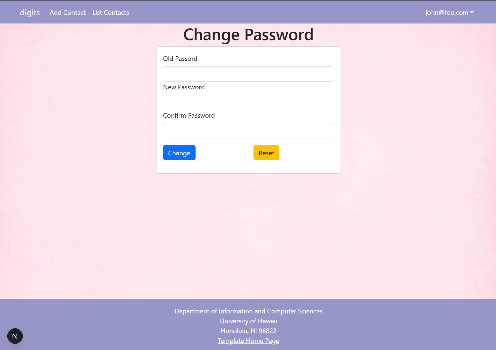
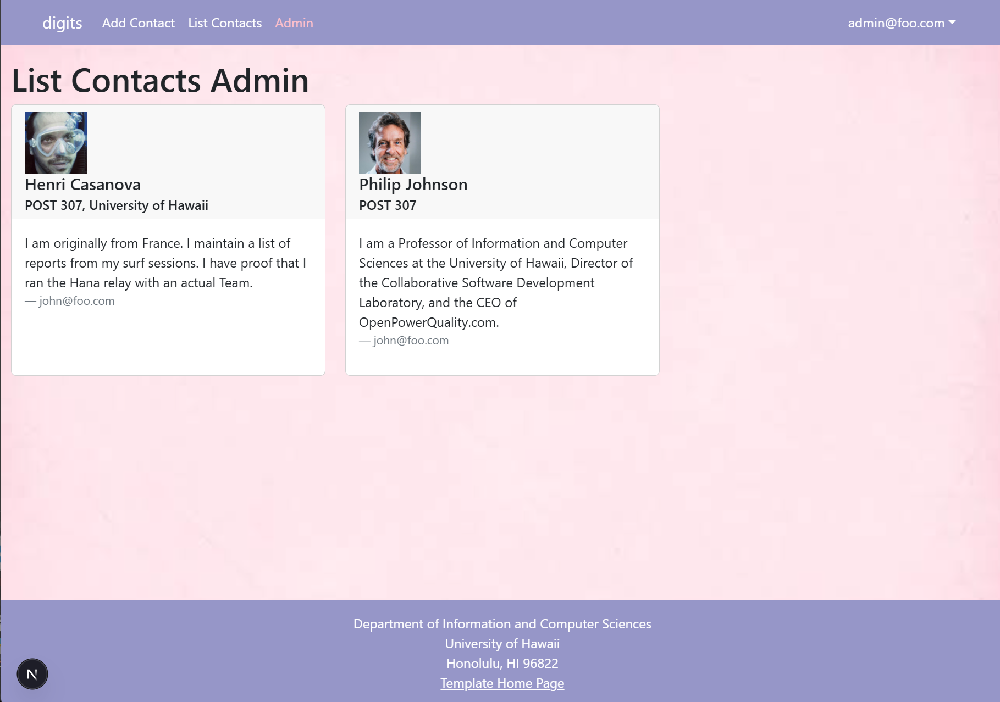

# Digits 

## Installation instructions 

Clone the repo and the following 

  npm install
  npm run dev

Next edit the .env file to set the DATABASE_URL to 
  postgresql://<username>:<password>@localhost:5432/digits?schema=public.

After editing the .env file, run the following command to set up the database
  npx prisma migrate dev
  mpx prisma generate
  npx prisma db seed

Finally, start Next.js by running npm run dev. 

## Page Walkthrough 

### Landing Page

### Sign in and Sign up 
At the top right of the landing page, there is a log in drop down where users can sign in if they already have an account or sign up to create a new account. 

### User Homepage

After logging in, users will see the homepage, which list the features of the website. At the top is the navbar where users can add contact and see the list of contact.

.png)

### Add Contact and List Contact Page 
Users can add contacts and see the list of contacts. In the List contacts page, users can add notes for each contact. 

### Changing Password
Users can also change their password by clicking on their email at the top right corner. This will display a dropdown where users can sign out or change their password. Users will need to remember their old password in order to set a new one.

### Admin Page

Admins has an additional feature in the website. In the navbar there is an Admin page where there are a different list of contacts only available to admins. 

